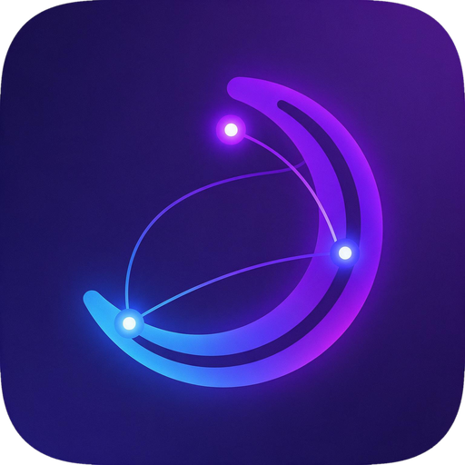

<p align="center"></p>

<p align="center"><a href="README.md">English</a> · <a href="README.fr.md">Français</a> · <b>Nederlands</b> · <a href="README.de.md">Deutsch</a> · <a href="README.es.md">Español</a></p>

# Nodelight

Een **draagbare Moonlight-client voor Windows** die verbinding maakt met je Sunshine/Apollo-pc **via
Tailscale**: geen installatie, geen driver, geen beheerdersrechten en geen poort die je op je router
moet openzetten.

> **Door AI gegenereerd project.** Alle code, scripts en documentatie in deze repository zijn
> geschreven door **Claude Sonnet 5.5** (Anthropic), via Claude Code, onder leiding van de eigenaar
> van de repository ("vibe coding"). De code is **niet door een mens gecontroleerd** en is slechts
> **gedeeltelijk getest op een echte machine** (ze bouwt, start en toont de interface; een volledige
> stream via Tailscale is nog niet bevestigd): gebruik op eigen risico (zie "Verificatiestatus").

Deze repository is een **fork van [moonlight-qt](https://github.com/moonlight-stream/moonlight-qt)**:
de clientcode is die van Moonlight, met de wijzigingen van Nodelight als commits erbovenop (zie
`git log`). De oorspronkelijke repository is ingesteld als `upstream` om de updates op te halen. De
rest van dit bestand beschrijft alleen wat Nodelight toevoegt.

Nodelight is niet verbonden aan Tailscale Inc., het Moonlight-project of Artemis/Apollo/Sunshine.
Tailscale is een handelsmerk van Tailscale Inc.

## Hoe het werkt

| Onderdeel | Taal | Rol |
| --- | --- | --- |
| `bridge/` → `Nodelight.exe` | Go | Tailscale-node in userspace (`tsnet`) + lokale TCP/UDP-relay, start Moonlight |
| `app/`, `moonlight-common-c/`… → `client\NodelightClient.exe` | C++/Qt | De aangepaste Moonlight-client: "remote"-modus voor de relay, Apollo-optie voor een virtueel scherm overgenomen van Artemis, ingebouwde Tailscale-pagina, naam en icoon van Nodelight |

Moonlight streamt via UDP (video, audio, besturing) met ruwe sockets die niet door een SOCKS5-proxy
kunnen, en leest de poortnummers uit de RTSP-antwoorden van de host. Nodelight luistert daarom op
**dezelfde poorten als Sunshine** op een eigen loopback-adres per pc (`127.77.0.1`, `127.77.0.2`, …)
en stuurt ze door via het tailnet.

```
Moonlight ──► 127.77.0.1:47989/47984/48010 (TCP), :47998-48002 (UDP)
                 │  Nodelight (relay + tsnet/WireGuard, userspace)
                 ▼
          Sunshine/Apollo-host-pc  (via je tailnet)
```

Doorgestuurde poorten per host (basis 47989): TCP 47984, 47989, 48010 (+ 47990 met `--web-ui`),
UDP 47998, 47999, 48000, 48002.

## Gebruik

1. Dubbelklik op `Nodelight.exe`: **er opent geen console**, Moonlight start meteen (in draagbare
   modus dankzij een bestand `portable.dat`: instellingen en koppelingen blijven in de map).
   Nodelight sluit samen met Moonlight. Wat het anders zou tonen, wordt in `Nodelight.log`
   geschreven, en opstartfouten verschijnen in een dialoogvenster.
2. Bij de eerste start opent Moonlight zijn **Tailscale**-pagina (een knop met een netwerkicoon in de
   bovenste balk). Klik op **Connect**: er opent een webpagina om het apparaat te autoriseren (één
   keer). De identiteit wordt bewaard in `data\` (houd deze map privé; ze kan van pc naar pc
   gekopieerd worden). Er is geen pc nodig om te verbinden.
3. Eenmaal verbonden kies je zo nodig de **exitnode** (zie hieronder) en dan **Add a PC**: een naam en
   de Tailscale-naam of het IP van de pc, daarna **Save PCs**. De pc wordt meteen verwerkt.
4. De pc's verschijnen **automatisch** in Moonlight (`127.77.0.1`, `127.77.0.2`… in de volgorde van de
   lijst; wijzig die volgorde niet als er al pc's gekoppeld zijn). Koppel zoals gewoonlijk.

Vanuit een terminal gestart schrijft `Nodelight.exe` naar die terminal en stelt het de vragen van de
eerste start (handig met `--json` of `--no-launch`).

Handige opties: `--host naam=adres[:basispoort]` (herhaalbaar), `--hostname`, `--state-dir`,
`--no-browser`, `--json` (gebeurtenissen per regel), `--listen-prefix`, `--web-ui`, `--control-url`
voor een zelf gehoste Headscale-server, en `--exit-node` (zie hieronder).

### Instellingenpagina

Verbinding, exitnode, pc's en profielen stel je in zonder bestanden te bewerken, op twee manieren:

- **In Moonlight**: knop **Tailscale (Nodelight)** (netwerkicoon) in de bovenste balk. De pagina heeft
  aanklikbare bediening voor: de verbindingsstatus en **Connect / Disconnect** (plus een knop om de
  Tailscale-aanmeldpagina te openen), de **exitnode** (lijst uit je tailnet + **Apply exit node**),
  de **pc-lijst** (naam, adres, basispoort, lokaal adres `127.77.0.N`, groen bolletje als de pc
  antwoordt, **Add a PC** / ✕ / **Save PCs**) en de **profielen** (wisselen, verwijderen, aanmaken). De
  knop verschijnt alleen als Moonlight door Nodelight gestart is. Een kortere gelijkwaardige sectie
  blijft in de Instellingen staan.
- **In de browser** (noodoplossing): het adres staat in `Nodelight.log`
  (`Settings page: http://127.0.0.1:POORT/?token=…`) of in de terminal; zelfde inhoud.

Een **profiel** bundelt een Tailscale-identiteit, een apparaatnaam, een optionele controleserver
(Headscale) en een lijst pc's. Zo kun je van het ene Tailscale-netwerk naar het andere wisselen; elk
profiel bewaart zijn identiteit in `data\profiles\<naam>`, het standaardprofiel blijft in `data\`.
Profielen worden opgeslagen in `hosts.json` (bestanden van eerdere versies blijven geldig).

Opmerkingen:
- Verbinding verbreken, van profiel wisselen of de exitnode wijzigen **onderbreekt de lopende stream**.
- Een waarde op de opdrachtregel (`--exit-node`, `--host`…) geldt bij het opstarten zonder te worden
  opgeslagen; een keuze die je daarna in de pagina maakt, vervangt ze.
- Beveiliging: de server luistert alleen op `127.0.0.1`, elke aanroep vereist een willekeurig token dat
  bij elke start wordt gegenereerd (via een omgevingsvariabele aan Moonlight doorgegeven), en verzoeken
  waarvan de `Host`-header niet het lokale adres is, worden geweigerd (bescherming tegen "DNS
  rebinding"). Een ander programma in je Windows-sessie kan die omgeving wel lezen: dit is geen
  beveiligingsgrens tegen code die al op je pc draait.

### Host-pc die niet op Tailscale zit (exitnode)

Als je Sunshine/Apollo-pc geen Tailscale heeft maar een ander apparaat in hetzelfde lokale netwerk
(Home Assistant, NAS, Raspberry Pi…) **als exitnode** in je tailnet zit, kan Nodelight daarlangs gaan:

```json
{
  "exitNode": "homeassistant",
  "hosts": [ { "name": "bureau", "address": "192.168.1.20" } ]
}
```

- `exitNode`: Tailscale-naam of -IP van de exitnode (of `--exit-node`, of de lijst op de
  Tailscale-pagina). `address` is dan het **lokale adres** van de host-pc (`192.168.x.y`), gezien
  vanuit het netwerk van de exitnode.
- De exitnode moet goedgekeurd zijn in de Tailscale-beheerconsole (Machines → Edit route settings →
  Use as exit node). Het apparaat `nodelight` moet hem mogen gebruiken (met de standaard-ACL's is dat
  zo).
- Zelfde principe als een externe machine die deze exitnode gebruikt: als je pc het lokale adres van
  de host zo bereikt, zou Nodelight dat ook moeten kunnen. **Niet getest**: ik kon niet controleren
  of de `tsnet`-bibliotheek het UDP-streamingverkeer echt via een exitnode naar een lokaal adres
  stuurt. Dit is het eerste wat getest moet worden.
- Prestaties: de hele videostream loopt via de exitnode-machine, met WireGuard-versleuteling. Een
  kleine domoticaserver kan de doorvoer beperken; verlaag de videobitrate in Moonlight als het beeld
  hapert. Als de host Tailscale kan krijgen, is dat altijd eenvoudiger en sneller (directe
  verbinding, `100.x`-adres of MagicDNS-naam in plaats van het lokale IP, en geen exitnode meer).

### Kant van de host (Sunshine/Apollo)

- De host-pc moet in hetzelfde tailnet zitten en aan staan, met Sunshine/Apollo gestart. Nodelight
  meldt bij het opstarten of elke host op zijn HTTP-poort antwoordt.
- De Windows-firewall van de host moet Sunshine/Apollo toestaan op de Tailscale-interface (het
  betreffende netwerkprofiel); je Tailscale-ACL's moeten deze poorten toestaan.
- Sunshine staat koppelen (`origin_pin_allowed`) standaard alleen toe vanaf het lokale netwerk: als het
  koppelen geweigerd wordt, pas die instelling aan of koppel één keer op het LAN.
- Voor goede prestaties is een **directe** Tailscale-verbinding nodig (niet via een DERP-relay);
  WireGuard-versleuteling in userspace gebruikt wat CPU.

## De build verkrijgen zonder ontwikkelomgeving

Het programma wordt gebouwd op de gratis Windows-machines van GitHub Actions:

1. Tabblad **Actions** → **Build Windows x64 (portable)** → **Run workflow** (30 tot 60 minuten; een
   `push` naar `master` start het ook). De oorspronkelijke workflows van Moonlight (AppImage, Steam
   Link, Windows/macOS-ondertekening) zijn uit deze fork verwijderd: ze vragen geheimen die hier niet
   bestaan.
2. Download het artefact `Nodelight-win-x64` (een zip) en pak het uit: dat is alles.

De zip bevat de Visual C++-runtime (lokale kopie): geen vereisten op de doelmachine. Er worden geen
verhoogde rechten gevraagd (`asInvoker`-manifest, bridge in userspace, lokale poorten > 1024 alleen op
loopback). Het uitvoerbare bestand is niet ondertekend: SmartScreen kan om bevestiging vragen, en de
Windows-firewall kan een netwerkmachtiging voorstellen die je mag annuleren.

## Handmatig bouwen (Windows x64)

Vereisten: Go 1.26+, Git, Qt 6.11+ (MSVC), Visual Studio 2026 (of de versie die moonlight-qt vereist),
PowerShell.

```powershell
git clone --recurse-submodules https://github.com/BKNadir/Nodelight
cd Nodelight
.\scripts\build-bridge.ps1      # tests + dist\Nodelight.exe
.\setup-deps.ps1
scripts\build-arch.bat release  # vanuit een Qt + MSVC-opdrachtprompt
.\scripts\package.ps1           # dist\Nodelight-win-x64.zip
```

## Wat van Artemis komt, en wat niet

Artemis is een **Android**-client voor Apollo. Veel van zijn functies hebben op Windows geen zin of
bestaan al in moonlight-qt.

| Artemis-functie | Status hier |
| --- | --- |
| Virtueel scherm van Apollo | **Klaar**: selectievakje in de hostinstellingen + `--virtual-display` |
| Aangepaste resolutie en bitrate | Al aanwezig in moonlight-qt |
| Serveropdrachten van Apollo | Niet gedaan: vereist de fork van `moonlight-common-c` van Artemis (`LiSendExecServerCmd`) |
| Klembordsynchronisatie | Niet gedaan: HTTP-aanroepen `actions/clipboard` + `QClipboard`-integratie te schrijven |
| Virtuele knoppen, aanraak-trackpad, DeX, staand, SBS 3D… | Android-specifiek, niet van toepassing |

## Verificatiestatus — lees dit

Gecontroleerd in de ontwikkelomgeving (zonder Windows):
- relaytests (TCP heen en terug met half-sluiten, onafhankelijke UDP-stromen per client, verlopen van
  inactieve stromen, "alles of niets"-binding, nette afsluiting): OK met `-race`;
- tests van het inlezen van de configuratie, de profielen en de invoer bij de eerste start;
- controllertests (verbinden met of zonder pc's, verbreken, verbinding die op autorisatie wacht,
  fouten, exitnode wijzigen tijdens gebruik, pc-lijst, profiel wisselen en verwijderen) en tests van
  de lokale API (token, `Host`-controle, validatie), met een nep-Tailscale, meermaals uitgevoerd met
  `-race`;
- de JavaScript-logica van de QML-pagina's is onder Node uitgevoerd met de echte JSON van de Go-code;
- de wijzigingen aan de client passen schoon op de upstream-commit `3178022` van moonlight-qt.

Vastgesteld door de auteur op Windows: de GitHub Actions-build slaagt, de applicatie start, de
iconen staan op de juiste plaatsen en de Tailscale-pagina opent in Moonlight.

**Niet geverifieerd** (te testen):
- de echte Tailscale-verbinding vanuit de applicatie (autorisatie, lijst van exitnodes);
- het echte routeren van verkeer via een exitnode met `tsnet` (vooral UDP);
- een volledige stream via Tailscale, en het gedrag van firewall/ACL's;
- het aansluiten op de terminal, het logbestand en de dialoogvensters van `Nodelight.exe` in alle gevallen.

Als een stap mislukt, open dan een issue met de foutmelding (en `Nodelight.log`): de meest
waarschijnlijke oorzaken zijn een verschil in de `tsnet`-API (aan te passen in
`bridge/cmd/nodelight/tunnel_ts.go`) of een poort die al in gebruik is op het loopback-adres (bijvoorbeeld
een lokale Sunshine).

## Licentie

GPL-3.0 (zie `LICENSE`): de code is afgeleid van moonlight-qt. Gedetailleerde vermeldingen in
`licenses/NOTICE.md`.
